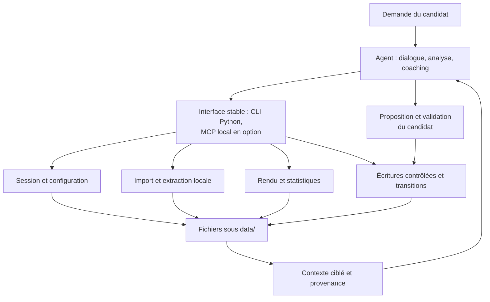
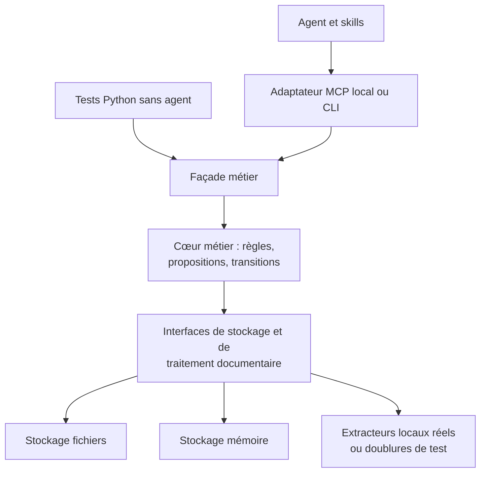

# Audit exploratoire : instructions du coach et traitements locaux

Date : 2026-10-16. Base inspectée : `0.4.0-dev`.
Statut : recommandations à discuter, aucune décision d'architecture adoptée.

**Recommandation : conserver l'agent comme coach et lui fournir un petit noyau
Python local pour exécuter les opérations répétitives et contrôler les données.**
Commencer par le démarrage et les imports. Une bibliothèque commune, exposée
par quelques commandes stables, suffit comme première architecture ; MCP peut
ensuite être un adaptateur de cette bibliothèque. Pour les documents, privilégier
une extraction légère lorsque le format le permet, avec un traitement de mise
en page ou un OCR local seulement quand nécessaire.

Le bénéfice attendu vient surtout de la suppression des allers-retours avec le
modèle, des scripts improvisés et de la retranscription générée token par token.
Il ne dépend pas principalement du langage choisi pour lire quelques fichiers.

## Périmètre et niveau de preuve

L'audit couvre les trois skills distribués, leurs références, les instructions
racines, les modèles et l'architecture documentaire, les décisions, le backlog,
les enseignements, le build, le plan et le journal de tests, plusieurs sessions
historiques, le scénario maître, son générateur et l'exemple fictif. Les
capacités des technologies proposées ont été vérifiées dans leurs sources
officielles, référencées près des comparaisons.

Il s'agit d'une inspection statique et documentaire, **pas d'un benchmark**.
Les durées historiques ne permettent pas d'isoler le modèle, les outils,
l'interface, les permissions et le disque. Aucun extracteur concurrent n'a été
installé ou exécuté pour comparer ses performances. La commande `python` n'a
pas pu être exécutée dans cet environnement d'audit ; cela ne démontre pas
l'absence de toute installation Python sur la machine.

Contraintes exprimées : Windows d'abord, portabilité souhaitée, Python
acceptable, traitements auxiliaires locaux et gratuits, pas d'API documentaire
externe. L'agent IA choisi reste le seul destinataire externe possible du
contexte nécessaire au coaching. Cette exception ne vaut pas autorisation
d'ajouter une autre API de modèle dans un extracteur.

La sélection d'une release et le grooming restent distincts de cet audit.
La capture correspondante est dans [BACKLOG.md](../../BACKLOG.md). Aucun état
de test n'est modifié par cette analyse et aucun gain n'est déclaré validé.

## Constats propres au projet

| Constat vérifiable | Conséquence pour l'architecture |
| --- | --- |
| `init-workspace` demande détection de première session, vérification des fichiers, recherche de perte, copie des modèles et comparaison YAML à chaque session. | Une procédure déterministe est réinterprétée par le modèle ; un service local peut l'exécuter et retourner un résultat compact. |
| `interview-coach` renvoie à l'initialisation puis redemande configuration, statut et dossier complet avant de répondre. | Plusieurs couches prescrivent des lectures des mêmes données. Cela crée un risque de travail redondant, sans prouver que chaque agent relit réellement tout. |
| Les transcriptions Markdown existent déjà comme mécanisme de réutilisation, avec interdiction d'écraser l'original ou une transcription existante. | Il faut fiabiliser cette bonne architecture, pas introduire un second système documentaire concurrent. |
| Aucun extracteur partagé ni contrat d'extraction n'est livré dans `workspace/`. | La méthode de lecture dépend de l'environnement et des improvisations de l'agent. |
| Les versions du dossier, numéros de répertoire, décomptes, états et liens entre artefacts sont gérés par les instructions. | Les invariants mécaniques sont de bons candidats pour des fonctions testables. |
| Les transitions mettent à jour plusieurs Markdown ; les tests relèvent des points de reprise périmés. | L'écriture coordonnée mérite un traitement commun, distinct du choix sémantique de la prochaine action. |
| Le build et la génération du kit sont déjà du code, séparés conformément aux règles du dépôt. | Conserver cette séparation ; ne pas faire installer Python ou des modèles par `build.bat`. |

Sources locales : [initialisation](../../workspace/skills/init-workspace/SKILL.md),
[coach](../../workspace/skills/interview-coach/SKILL.md),
[transcriptions](../../workspace/skills/interview-coach/references/professional-profile-guidelines.md),
[états et versions](../../workspace/AGENTS.md),
[opportunités](../../workspace/skills/interview-coach/references/opportunity-structure-guidelines.md).

Deux observations historiques sont particulièrement probantes :

- Le [déroulé du 2026-10-02](../test-history/2026-10-02-deroule-complet-scenario-maitre.md)
  signale un démarrage supérieur à une minute et un tableau de certification
  extrait dans le désordre, sans outil de rendu disponible.
- Le [test du 2026-10-11](../test-history/2026-10-11-tests-manuels-9-corrections.md)
  décrit l'absence d'extracteur utilisable, un décodage improvisé ASCII85/Flate,
  un script cassé par l'échappement du shell, des opérateurs PDF résiduels et des
  symboles « € » perdus puis rétablis d'après le contexte. Le résultat jugé
  acceptable par le scénario ne valide donc pas la méthode d'extraction.

Mesure statique indicative, en caractères et non en tokens : `workspace/AGENTS.md`
contient environ 21 000 caractères, `init-workspace/SKILL.md` 13 200 et
`interview-coach/SKILL.md` 16 200. Ces trois fichiers représentent environ
50 000 caractères avant les références et les données. C'est un volume à
examiner, **pas une mesure de ce que chaque outil injecte ou facture réellement**.
L'injection automatique, les relectures et les caches de contexte varient selon
l'application. Les réduire exige de mesurer le contexte effectivement transmis.

## Répartition recommandée entre code et agent

L'ordre ci-dessous exprime le rendement technique attendu, à confirmer par
mesure. Il ne fixe pas le contenu d'une prochaine release.

| Partie | À confier au programme | À conserver au modèle / candidat | Intérêt et complexité |
| --- | --- | --- | --- |
| Démarrage | Existence et lisibilité des fichiers, lecture ciblée, validation de configuration, diagnostic structuré, copie contrôlée des modèles. | Accueil, compréhension de la demande, choix du périmètre ambigu, dialogue en cas de perte. | Très prioritaire ; moyenne, car l'ordre de première session et les cas de perte sont sensibles. |
| Import documentaire | Copie à l'identique, identification du format, extraction, OCR au besoin, provenance, contrôles, réutilisation. | Catégorie ambiguë, choix des parties utiles, contradictions, proposition d'enrichissement. | Très prioritaire ; élevée pour les formats difficiles et les garanties de non-écrasement. |
| Création d'opportunités, entretiens, simulations | Identifiants, normalisation des noms, collisions, création progressive des fichiers. | Identification de l'organisation, du rôle et du type d'entretien depuis les sources. | Gain de fiabilité élevé ; moyenne. |
| Dossier professionnel | Validation de schéma, calcul de version, écriture d'une proposition validée, historique cohérent. | Synthèse, pertinence des faits, décision de passage à « prêt », accord du candidat. | Fiabilité élevée ; élevée à cause des validations, sessions et éditions manuelles. |
| Continuité et transitions | Liens, artefacts existants, propagation des métadonnées, détection des incohérences explicites. | Résumé de la situation, prochaine action pertinente, arbitrage entre sujets. | Importante ; élevée. Ne pas prétendre déduire tout état métier d'un Markdown libre. |
| Feedback produit | Append, identifiants, noms de fichiers, décomptes, sélection des entrées, écriture avant marquage « traitée ». | Reconnaissance d'une difficulté, revue avec le candidat, synthèse, contrôle des données identifiantes. | Moyenne ; coût modéré des calculs mais fiabilité utile. |
| Transcripts et jokers | Si l'application expose les événements : enregistrement exact, marqueurs structurés, comptage et rendu. | Conduite de l'entretien, compréhension des demandes ambiguës et débrief. | Variable ; élevée pour plusieurs applications. Un outil ne peut pas récupérer une conversation inaccessible. |
| Fiches et autres livrables | Gabarits, rendu, pagination, régénération et vérification des fichiers produits. | Contenu, sélection des exemples et conseils, validation. | Utile après les imports ; moyenne à élevée selon la fidélité attendue. |
| Contrôles du toolkit | Structure, liens, invariant des originaux, versions, cohérence des tableaux de tests, mesures de performance. | Évaluation de la qualité du coaching et des réponses ouvertes. | Moyen ; complète les tests humains, ne les remplace pas. |

La transcription et l'extraction des faits sont deux opérations différentes.
Un parseur peut récupérer une date, une ligne et un tableau. Déterminer s'il
s'agit de la durée d'un poste, d'une certification ou d'une mission imbriquée
peut exiger le modèle. De même, des dates qui se chevauchent ne prouvent pas
une contradiction : un contrôle peut signaler, pas trancher.

## Architecture proposée

### Un noyau, deux interfaces possibles

**Premier choix : bibliothèque Python et CLI.** Les commandes doivent porter
sur un besoin complet : préparer une reprise, importer un lot, créer une
opportunité. Exposer chaque `exists`, `read` et `mkdir` comme un outil séparé
conserverait les allers-retours que l'on cherche à supprimer. Les sorties
doivent donner un statut, les changements réellement appliqués, les erreurs,
les chemins utiles et un contenu borné. Ne pas renvoyer systématiquement tout
le JSON de mise en page ou toutes les transcriptions dans la conversation.

Noms illustratifs, non implémentés : `session inspect`, `session initialize`,
`sources import`, `opportunities create`, `profile propose`, `profile apply`,
`feedback append`, `workspace check`.

**MCP local en option.** Avantages : arguments et résultats structurés,
intégration avec les clients compatibles, processus éventuellement persistant
pour garder un OCR chargé. Inconvénients : configuration par application,
compatibilité à vérifier, coût des descriptions d'outils dans le contexte et
gestion du cycle de vie. Il ne rend ni l'extraction ni le modèle plus rapides
par nature. Le transport stdio lance un sous-processus local ; le SDK Python
évite d'introduire un noyau Node.js uniquement pour MCP.
[Transport stdio](https://github.com/modelcontextprotocol/modelcontextprotocol/blob/main/docs/specification/draft/basic/transports/stdio.mdx),
[SDK Python](https://py.sdk.modelcontextprotocol.io/advanced/low-level-server/).

Un agent qui sait lire un répertoire ne sait pas nécessairement exécuter une
commande. La compatibilité réelle doit donc distinguer accès fichiers,
exécution locale et prise en charge de MCP. Aucun support universel ne peut
être promis à partir du seul accès au dossier.

### Démarrage : inspecter une fois, charger selon le besoin

1. Première session : ne vérifier que les indices autorisés d'existence ; lire
   la configuration préexistante pour la langue si nécessaire. Respecter
   l'accueil et l'attente de la réponse au prénom avant toute initialisation.
2. Session existante : lire ensemble configuration, statut racine et en-tête
   du dossier ; retourner les données utiles et les anomalies. Une session
   inchangée ne doit provoquer aucune écriture de maintenance inutile.
3. Charger le dossier complet quand le travail métier l'exige, puis seulement
   l'opportunité et l'entretien concernés. Éviter les relectures identiques
   pendant le même tour ; relire après changement ou invalidation.
4. Charger les instructions de simulation, feedback ou rendu au moment où
   elles deviennent pertinentes. Le contrat métier reste dans les skills ;
   les algorithmes mécaniques et leurs détails passent dans le code.

Une optimisation qui supprimerait la lecture complète prescrite aujourd'hui
par `interview-coach` serait une modification fonctionnelle à revoir et tester,
pas une simple astuce technique. Il faut préserver la connaissance des faits
nécessaires et la correction des états périmés.

Ne pas remplacer la détection existante par un marqueur « initialisé » : il
masquerait les suppressions ou initialisations partielles. Un cache éventuel
doit rester dérivé et invalidable. Ne charger aucun moteur OCR au démarrage
normal. Les installations et téléchargements de modèles appartiennent à la
préparation de l'environnement, pas au lancement d'une conversation.

### Python, PowerShell, Node.js et distribution

| Choix | Avantages | Inconvénients / position recommandée |
| --- | --- | --- |
| Python | Écosystème documentaire directement utilisable, portable, tests simples, bibliothèque et CLI partageant le code. | Dépendances et interpréteur à installer et verrouiller. Choix recommandé pour le noyau. |
| PowerShell | Bon lanceur Windows, déjà présent dans le build ; adapté aux tâches d'installation et d'emballage. | PowerShell 5.1 et 7 diffèrent ; portabilité et traitement documentaire moins directs. Garder de petits lanceurs. |
| Node.js / TypeScript | Pertinent pour une interface web ou un écosystème d'intégration déjà en TypeScript. | Aucun gain identifié pour le cœur documentaire ici ; ajouterait souvent un second environnement autour des bibliothèques Python. |
| Exécutable Python empaqueté | Simplifie potentiellement le premier usage sans Python installé. | Archives plus volumineuses, fabrication par OS, gestion des modèles et mises à jour plus délicate. À évaluer après stabilisation du noyau. |

Pour commencer : environnement Python isolé, dépendances épinglées et commande
de diagnostic de l'installation. `venv` et `pip` suffisent ; **uv** est une
option pratique pour verrouiller et préparer les dépendances, avec mode hors
ligne. Ne pas faire un `uvx` non épinglé ou une résolution réseau à chaque
session. L'exécution courante peut appeler directement l'interpréteur préparé.
[Verrouillage uv](https://docs.astral.sh/uv/concepts/projects/sync/),
[options hors ligne](https://docs.astral.sh/uv/reference/cli/).

Le code distribué reste dans le moteur, les caches et journaux privés sous
`data/`, et l'environnement installé reste séparé du ZIP source. Le build
possède une liste d'entrées racines autorisées : ajouter un répertoire de code
impliquera d'adapter ce contrôle et les tests de distribution. `build.bat`
doit continuer à emballer uniquement, sans installation ni accès réseau.

## Extraction documentaire : comparaison des solutions

Les appréciations ci-dessous sont des choix d'ingénierie, pas un classement
mesuré sur le toolkit. Les bibliothèques, modèles, langues et paramètres
devront être épinglés pour rendre la comparaison reproductible.

| Solution | Avantages | Limites | Emploi conseillé |
| --- | --- | --- | --- |
| **MarkItDown, convertisseurs locaux** | Interface Python commune pour plusieurs formats et sortie Markdown ; licence MIT ; dépendances par format. | Ne garantit pas une transcription fidèle de toutes les mises en page. Les extensions cloud et OCR via LLM ne répondent pas au besoin local par défaut. | Premier candidat pour DOCX et formats Office courants ; candidat léger pour les PDF simples. |
| **python-docx** | Accès explicite aux paragraphes, tableaux et métadonnées ; contrôle fin de l'extraction. | Il faut fabriquer le Markdown et traiter les objets particuliers ; parcourir seulement `document.paragraphs` omet les tableaux. | Si MarkItDown ne préserve pas assez bien la structure nécessaire, ou pour produire du DOCX. |
| **pypdf** | Lecture PDF sans chaîne OCR, dépendance légère ; approprié aux fichiers textuels simples. | Pas d'OCR, ni garantie sur l'ordre visuel ou les tableaux ; certains contenus peuvent coûter beaucoup de mémoire. | Inspection et extraction simple, avec limites de ressources et escalade explicite. |
| **pdfplumber** | Géométrie des caractères et lignes, extraction de tableaux, possibilités de diagnostic. | Conçu surtout pour PDF produits numériquement ; réglages nécessaires et pas d'OCR intégré. | Candidat ciblé pour le tableau du certificat et les PDF où les coordonnées aident. |
| **PyMuPDF / PyMuPDF4LLM** | Moteur natif, extraction, rendu et conversion adaptée aux colonnes/tableaux ; candidat pertinent pour la vitesse. | Licence AGPL ou commerciale : son intégration et sa redistribution doivent être examinées pour ce dépôt MIT. Les résultats restent à tester. | Alternative sérieuse au chemin PDF léger si les conditions de licence retenues conviennent. |
| **Docling** | Analyse de mise en page, tableaux, ordre de lecture, export structuré et OCR ; fonctionnement local possible. | Modèles et dépendances plus lourds, démarrage à froid et consommation CPU/RAM à mesurer. | Premier candidat pour la voie documentaire complexe, pas pour chaque lancement de session. |
| **Tesseract** | OCR local éprouvé, modèles linguistiques FR/EN disponibles, installation Windows documentée. | Binaire et données linguistiques à prévoir ; OCR seul ne reconstitue pas un CV complexe. | Référence de comparaison pour scans lisibles ; combiné à un moteur de rendu et de structure. |
| **RapidOCR + ONNX Runtime** | Autre voie OCR locale, intégrable dans une chaîne Python ; exécution CPU envisageable. | Modèles, langues et licences des poids à vérifier ; tester notamment accents et chiffres français. | Challenger de Tesseract pour faciliter le déploiement et mesurer le rapport qualité/latence. |
| **OCRmyPDF** | Ajoute une couche texte aux PDF scannés et permet une réutilisation documentaire. | Installation Windows avec plusieurs dépendances ; produit un PDF OCRisé, pas directement une transcription métier. | Option si le PDF consultable et recherchable devient lui-même un besoin ; conserver l'original séparément. |

Sources primaires pour cette comparaison :
[MarkItDown](https://github.com/microsoft/markitdown),
[python-docx](https://python-docx.readthedocs.io/en/latest/api/document.html),
[pypdf](https://pypdf.readthedocs.io/en/6.4.0/user/extract-text.html),
[pdfplumber](https://github.com/jsvine/pdfplumber/blob/stable/README.md),
[PyMuPDF et licence](https://pymupdf.readthedocs.io/en/latest/faq/index.html),
[PyMuPDF4LLM](https://github.com/pymupdf/pymupdf4llm),
[Docling](https://github.com/docling-project/docling),
[Tesseract](https://tesseract-ocr.github.io/tessdoc/Installation.html),
[RapidOCR](https://github.com/RapidAI/RapidOCR),
[OCRmyPDF sur Windows](https://ocrmypdf.readthedocs.io/en/latest/installation.html).

**État de l'art à distinguer de la simplicité du produit.** Les chaînes
modernes combinent parseurs, reconnaissance de mise en page, tableaux et OCR.
PaddleOCR/PP-StructureV3 est un autre candidat pour le traitement structurel.
Les modèles vision-langage locaux peuvent traiter des documents difficiles,
mais ajoutent un coût matériel et des risques d'omission ou de génération.
Ils ne constituent pas automatiquement la meilleure solution pour des CV
courts sur un PC Windows sans GPU dédié. Les comparer seulement si les
solutions précédentes échouent sur le corpus utile.
[PP-StructureV3](https://github.com/PaddlePaddle/PaddleOCR/blob/main/docs/version3.x/pipeline_usage/PP-StructureV3.en.md),
[rapport PaddleOCR 3.0](https://arxiv.org/abs/2507.05595).

Docling peut précharger ses modèles pour travailler hors ligne ; ses services
distants sont une option distincte. Il faut désactiver explicitement les voies
distantes et tester l'exécution réseau coupé, pas seulement constater que
l'entrée est un chemin local.
[Configuration hors ligne de Docling](https://docling-project.github.io/docling/usage/advanced_options/).

### Combinaison recommandée à éprouver

- TXT/Markdown : copie ou conservation exacte, avec contrôle de l'encodage ;
  aucune reformulation et aucun passage par OCR.
- DOCX : MarkItDown local comme premier essai ; python-docx si les tests
  imposent un contrôle plus fin. Détecter les éléments ignorés, par exemple
  images porteuses de texte et objets non pris en charge.
- PDF avec texte simple : comparer pypdf et la voie PDF de MarkItDown ;
  comparer aussi PyMuPDF si la voie de licence convient. Ne pas maintenir
  tous ces moteurs si un seul satisfait le corpus léger.
- PDF à structure difficile : Docling, avec pdfplumber comme alternative
  ciblée pour certains tableaux. Activer seulement les fonctions utiles.
- Scan, image ou pages mixtes : OCR local sur les pages ou zones nécessaires,
  puis reconstruction de structure ; comparer Tesseract et RapidOCR sur FR/EN.
- Échec : résultat explicitement incomplet ou arrêt avec alternative utile.
  Aucun retour au décodage PDF improvisé ni réparation silencieuse par le LLM.

Pour éviter un double traitement systématique, le routage se fait d'abord
avec des indices simples : couche texte, pages image, caractères anormaux,
géométrie et tableau probable. Un contrôle peut détecter un texte vide ou
manifestement dégradé ; il ne prouve pas que le texte a été extrait fidèlement.
Les échecs de structure doivent pouvoir entraîner un examen ciblé de l'original.

### Contrat d'import et réutilisation

Chaque import devrait produire une transcription lisible et un petit relevé
technique : empreinte SHA-256 de l'original, outil/version, paramètres et langue
OCR, date, pages traitées, limites et localisation des passages. Page et zone
sont utiles pour un PDF ; paragraphe ou cellule pour un DOCX. Les identifiants
de provenance doivent rester stables et utilisables dans les propositions du coach.

Le programme peut écrire la transcription directement sans demander au modèle
de la réécrire. Le modèle consomme ensuite le texte utile pour proposer le
dossier ou l'opportunité. Cela économise surtout la génération de la copie et
les appels d'outils ; cela ne supprime pas les tokens nécessaires à la lecture
et à la compréhension des informations.

Le cache doit prendre en compte **le contenu, la version du moteur et les
paramètres**, pas seulement le nom ou la date de modification. Réutiliser une
transcription existante et compatible ; si l'original ou le moteur change,
signaler le cas et respecter la règle actuelle de nouvelle transcription datée.
Une transcription éditée à la main ne doit pas être écrasée au motif qu'elle
est « dérivée ». Une ancienne transcription sans empreinte nécessite une
reconciliation explicite, pas une association supposée exacte.

Cas à résoudre dans la spécification : `cv.pdf` et `cv.docx` donnent aujourd'hui
tous deux `cv.md` ; la règle de nommage et la règle de non-écrasement ne
définissent pas complètement cette collision. L'import doit la détecter avant
d'écrire. L'empreinte permet aussi de reconnaître deux fichiers identiques
sans supprimer ni fusionner automatiquement les originaux.

Le seuil de « très volumineux » n'est pas fixé dans D-011. Un programme peut
mesurer pages et taille avant traitement, mais un seuil d'acceptation est une
décision produit à discuter. Ne pas transcrire un lot lourd en arrière-plan
pendant que le coach attend l'accord exigé par le workflow.

## Fiabiliser les écritures et les états

**Configuration.** Un schéma strict doit distinguer clé absente et valeur
invalide, conserver les clés inconnues et appliquer les défauts en mémoire
quand la réécriture est interdite. `ruamel.yaml` facilite la conservation des
commentaires, mais ne garantit pas une identité octet à octet hors changement.
Une insertion ciblée avec contrôle du diff peut être nécessaire pour respecter
exactement les règles actuelles. YAML mal formé ou fichier illisible : aucun
remplacement automatique.
[Documentation ruamel.yaml](https://yaml.dev/doc/ruamel.yaml/detail/).

**Versions et validation.** Traiter `0.9 → 0.10` comme deux entiers, jamais
comme un nombre décimal. La règle « une incrémentation par conversation »
nécessite une identité de session et un suivi explicite : une reconnexion MCP
ou un nouveau processus ne doit pas compter comme une nouvelle conversation.
Si l'application n'expose pas cette identité, le contrat avec l'agent doit la
fournir et ses limites doivent être testées.

**Proposition puis application.** Préparer un changement avec l'empreinte des
fichiers de départ ; après accord, appliquer uniquement cette proposition si
les fichiers n'ont pas changé. Sinon demander une nouvelle revue. Un paramètre
`approved=true` transmis par l'agent ne constitue pas une preuve technique
indépendante du consentement humain. Le dialogue reste responsable de cet
accord, sauf ajout d'une interface de confirmation réellement contrôlée.

**Identifiants.** `max + 1` est mécanique, mais scanner uniquement les dossiers
présents peut réutiliser le dernier numéro si celui-ci a été supprimé. Il faut
clarifier la portée de « jamais réutilisé » et, si elle inclut ce cas, conserver
un compteur durable ou des réservations. Protéger aussi deux créations
concurrentes et les noms Windows réservés, accents, chemins longs et collisions.

**Persistance.** Écriture temporaire puis remplacement pour un fichier,
vérification de préconditions et verrouillage local si nécessaire. Plusieurs
fichiers Markdown ne deviennent pas une transaction atomique par magie :
prévoir un journal d'opération et une reprise après interruption. Les verrous
locaux ne règlent pas une édition simultanée sur plusieurs PC synchronisés.
Une erreur doit préserver les originaux et rendre la reprise possible.

**État métier.** Garder Markdown comme source lisible, en accord avec D-001 et
D-005. Ajouter un petit contrat structuré seulement pour les métadonnées qui
doivent être calculées. Éviter deux sources concurrentes : définir pour chaque
champ si sa référence est le Markdown ou un état structuré, et comment une
édition manuelle est détectée. SQLite peut convenir à un index/cache local
reconstructible ; une base métier complète n'est pas justifiée à ce stade.

Un `workspace check` doit séparer les incohérences certaines (lien cassé,
version invalide) des divergences de sens à soumettre au coach. Il ne doit pas
réécrire un dossier ni décider seul qu'une opportunité est terminée.

## Autres traitements à déplacer, sans détourner la priorité

**Feedback.** Un append et des décomptes ne nécessitent pas de LLM. Un outil
peut garantir le format, les suffixes de fichier et l'ordre « écrire le
feedback, puis marquer ses entrées ». Prévoir la reprise si l'écriture réussit
mais que le marquage échoue. Les statistiques viennent de la source prescrite :
journal pour le feedback produit, marqueurs du transcript pour le débrief.

**Anonymisation.** Détection locale des courriels, téléphones et chemins, liste
de remplacements cohérents et éventuellement reconnaissance d'entités avec
Presidio. Cela réduit les oublis mécaniques, sans détecter tous les détails
réidentifiants d'un parcours. Le coach et le candidat gardent la revue finale.
Ne pas charger un modèle de reconnaissance d'entités à chaque démarrage pour
une fonction utilisée seulement à la génération du feedback.
[Presidio : fonctionnement](https://microsoft.github.io/presidio/text_anonymization/),
[installation et moteurs NLP](https://microsoft.github.io/presidio/installation/).

**Rendu.** La consigne « première page autonome » et `<!-- PAGE BREAK -->`
nécessitent une chaîne de rendu pour devenir une garantie vérifiable.

| Solution | Avantage | Inconvénient |
| --- | --- | --- |
| HTML/CSS + Chromium piloté par Playwright Python | Moteur courant, styles d'impression, prévisualisation HTML et PDF ; API Python. | Navigateur à distribuer/préinstaller, lancement coûteux ; contrôler les débordements et bloquer les ressources externes. |
| HTML/CSS + WeasyPrint | Orienté documents paginés, compatible avec une chaîne Python. | Installation Windows et dépendances natives à valider ; différences de rendu CSS. |
| Génération DOCX puis export local | Document éditable, intéressant si ce livrable est demandé. | Moteur bureautique supplémentaire pour le PDF et possibles différences de pagination. |

Pour les fiches, je testerais d'abord HTML/CSS et Playwright Python ; cela
n'impose pas un projet applicatif Node.js supplémentaire. Les polices, images
et styles doivent être locaux. Le rendu ne doit se déclencher que si le
document source ou le gabarit change et que le livrable est demandé.
[PDF avec Playwright](https://playwright.dev/python/docs/api/class-page#page-pdf),
[installation Playwright](https://playwright.dev/python/docs/intro),
[installation WeasyPrint](https://doc.courtbouillon.org/weasyprint/stable/first_steps.html).

**Tests.** Automatiser les invariants de fichiers, les transitions et les
comparaisons d'extraction. Garder des scénarios réels d'agent pour la validation,
les ambiguïtés et la qualité du coaching. Un test de fonction Python ne valide
pas que le coach appelle la fonction au bon moment. Éviter une architecture
multi-agent ou une base vectorielle pour résoudre d'abord ces problèmes simples.

## Confidentialité : ce que le noyau peut garantir

Le noyau peut être conçu sans accès réseau pendant le traitement, avec modèles
préinstallés, convertisseurs locaux, chemins contrôlés et ressources de rendu
locales. Tester ce mode réseau coupé. Les journaux de performance devraient
contenir durées, compteurs et codes d'erreur, sans texte extrait ni noms de
candidats. Les caches d'extraction contiennent des données personnelles et
doivent rester dans l'espace privé, avec suppression et export maîtrisés.

Un chemin local n'implique pas un stockage exclusivement local : un dossier
synchronisé peut être répliqué par le système. Le produit devra préciser
l'emplacement compatible avec l'exigence exprimée, sans supposer la politique
de synchronisation effective de la machine. Le noyau ne peut pas non plus
garantir les pratiques du fournisseur IA à partir d'un réglage « pas
d'entraînement ». La conservation et les accès sont des dimensions distinctes,
déjà relevées dans [docs/privacy.md](../privacy.md).

Réduire le contexte transmis reste utile : extraire tout localement, présenter
au modèle seulement ce qui sert à la tâche et revenir aux sources au besoin.
La minimisation ne doit pas masquer un passage qui contredit la synthèse.

## Couverture existante et protocole à prévoir

Comptage effectué le 2026-10-16 des cellules de statut exactes des tableaux de
[docs/test-log.md](../test-log.md) : **56 « Validé », 44 « À revalider »,
30 « Non testé », 2 « Problème constaté »**. Les 132 lignes ne sont ni des tests
uniques ni un pourcentage de qualité : les sections se recouvrent.

| Groupe du journal | Validé | À revalider | Non testé | Problème |
| --- | ---: | ---: | ---: | ---: |
| Synthèse générale | 6 | 6 | 1 | 0 |
| Zones sans test consigné | 0 | 4 | 2 | 0 |
| Kit de test #12 | 6 | 7 | 2 | 0 |
| Abandon standalone #14 | 9 | 1 | 1 | 0 |
| Démarrage/recentrage #15 | 4 | 7 | 6 | 0 |
| Joker #18 | 6 | 4 | 2 | 1 |
| Confidentialité #8 | 11 | 3 | 0 | 0 |
| Statut/version #9 | 5 | 11 | 2 | 1 |
| Feedback produit #17 | 9 | 1 | 14 | 0 |

Écarts pertinents pour ce chantier : initialisation et configuration à
revalider, reprise après perte partiellement couverte, numérotation non rejouée
complètement, mise à jour et rollback incomplets, ordre des écritures du
feedback non vérifié, journal long non testé. Les deux problèmes ouverts
concernent la répétition d'une sortie de rôle de joker et la cohérence de la
prochaine action après changement d'état du dossier. La confidentialité du
dépôt et une zone générale de régression restent aussi « Non testé ».

Le [plan](../test-plan.md) contient déjà des scénarios de fidélité, volume,
non-écrasement et reprise. Il manque un protocole reproductible de latence et
tokens, un corpus de scans/mises en page difficiles, des attentes d'extraction
vérifiables automatiquement et les cas propres au cache ou aux écritures
interrompues. Les durées de démonstration comprennent le dialogue et les
manipulations du testeur ; elles ne mesurent pas la performance d'un extracteur.

Le kit actuel constitue un bon départ : PDF et DOCX fictifs avec références
Markdown, certificat avec tableau, offres FR/EN et livret de 49 pages. Cependant,
ils proviennent d'un même générateur simple. Ajouter des scans, rotations,
PDF mixtes, CV à colonnes, tableaux sans bordures, ligatures, accents, « € »,
documents endommagés/chiffrés, DOCX avec tableaux imbriqués/en-têtes/images,
mêmes noms de base et originaux modifiés. Les cas négatifs peuvent attendre
un refus explicite, pas forcément une conversion réussie.

L'[exemple fictif](../../examples/README.md) date du 2026-10-02 et documente
lui-même son retard, dont l'absence de transcription des offres. Il ne peut
pas servir de référence exhaustive du comportement courant. Une future passe
validée devra le renouveler selon la procédure prévue, sans fabriquer un
résultat présenté comme issu d'un test réel.

### Mesures proposées, toutes non exécutées dans cet audit

| Famille | Scénarios | Mesures et critères |
| --- | --- | --- |
| Démarrage | B1, B2, B4/B5, B8, E3 ; espace vide puis rempli ; fichier manquant ou modifié à la main. | Temps jusqu'à l'accueil utile et jusqu'à la reprise effective, nombre d'appels, lectures/écritures, volume de contexte. Aucun gain au prix d'une perte silencieuse ou d'une initialisation prématurée. |
| Import | C1/C5/C6, D1 et E1 ; fichier simple, lot, tableau, scan, réimport identique. | Temps d'extraction seul et temps total jusqu'à la proposition ; mémoire, taille du résultat, exactitude des dates/montants/tableaux et traçabilité. Originaux identiques. |
| Cache | Identique, contenu changé à taille identique, moteur/paramètres changés, transcription éditée, cache absent. | Réutilisation correcte, invalidation, aucun écrasement ; pas de relecture de tout l'historique pour un ajout. |
| Écritures | Interruptions, disque plein/droits insuffisants, deux appels concurrents, fichier changé après proposition. | Pas de perte, pas de validation supposée, pas de doublon ni numéro réutilisé ; reprise explicite. |
| Confidentialité | Machine préparée puis réseau coupé, document comportant liens/ressources externes. | Aucun appel externe de traitement, message utile si dépendance manque ; aucune donnée dans les métriques. |
| Agent complet | Parcours essentiel `[socle]` et tests affectés, sur les applications ciblées. | Appels au bon moment, conservation des validations, français/anglais, qualité de coaching et attente réellement perçue. |

Séparer installation, premier chargement à froid et reprises à chaud ; noter
machine, stockage, versions, modèle et mode d'autorisation. Répéter les cas
comparables et conserver médiane et dispersion. N'utiliser un percentile p95
qu'avec suffisamment d'observations ; cinq essais ne suffisent pas à en faire
un engagement fiable. Les tokens doivent provenir des métriques réellement
exposées par l'agent ; sinon rapporter caractères/octets et appels, pas un
compte de tokens inventé.

Cibles exploratoires à discuter : inspection locale d'une session inchangée
dans l'ordre de la seconde sur une machine de référence, un appel principal
pour cette inspection, aucune écriture inutile, et réduction sensible du délai
jusqu'à la reprise. Ce ne sont pas des performances mesurées ni une promesse
de réponse complète du modèle en une seconde. Pour les imports, fixer les
seuils après une première mesure par catégorie de document.

## Ordre technique conseillé et arbitrages restants

1. **Définir le modèle de domaine et confronter les fichiers actuels.**
   Décrire objets, relations, invariants et sources de vérité ; distinguer
   état courant, vue dérivée et trace historique ; relever les incohérences et
   leurs corrections possibles avant de fixer la façade. Complexité élevée.
2. **Mesurer et préparer l'environnement.** Diagnostic installé une fois,
   corpus et mesures séparées agent/outils ; supprimer le besoin d'inventer
   des méthodes d'extraction. Complexité moyenne.
3. **Noyau de démarrage et import léger.** Gain utilisateur le plus direct,
   avec dépendances limitées et tests des cas de perte. Complexité moyenne à
   élevée ; toute évolution du coach est fonctionnelle.
4. **Extraction complexe et cache.** Retenir les moteurs qui passent le corpus,
   avec OCR optionnel et bornes de ressources. Complexité élevée.
5. **Écritures, identifiants et états.** Mutualiser les opérations et renforcer
   les invariants sans réécrire le coaching. Complexité élevée.
6. **MCP, rendu et traitements secondaires.** Les ajouter lorsque compatibilité,
   mesures ou usages le justifient. Complexité moyenne à élevée selon le lot.

À décider après les mesures : moteur PDF léger, moteur OCR FR/EN, voie de
licence de PyMuPDF, distribution de l'environnement et des modèles, contrat
des métadonnées, identité de session, seuil de gros document et gestion des
collisions de transcription. La présence d'un GPU ne doit pas être un prérequis
silencieux ; le premier benchmark doit être pertinent pour un PC pilote CPU.

Avant toute implémentation, suivre le processus du dépôt : revue et commit de
la capture, grooming séparé, scénarios d'acceptation « Non testé » revus avec
l'auteur et plan de l'issue. Les propositions de ce rapport ne modifient pas
les décisions D-004, D-005, D-010, D-011, D-014 ou D-022. Les changements retenus
devront synchroniser instructions, documentation et tests dans leur propre lot.

Contrôles effectivement réalisés pour l'audit : lecture des sources citées,
inventaire et comptage statique, rapprochement du plan et du journal, recherches
documentaires officielles. Aucun parcours coach, OCR, import, build ou test de
performance n'a été rejoué. Aucune donnée personnelle n'a été utilisée.

## Complément : façade métier et stockage interchangeable

Proposition exprimée par l'auteur le 2026-10-16 après lecture de l'audit :
découpler complètement l'agent de la représentation physique des données,
par une façade éventuellement exposée en MCP. Objectifs supplémentaires :
évolution indépendante des composants, tests Python sans agent et démonstration
avec modèle de données en mémoire. Cette section explore la proposition ;
elle n'adopte pas un nouveau stockage ni un périmètre de release.

### Modèle de domaine et adéquation des fichiers actuels

Avant de figer les opérations de la façade ou les représentations mémoire et
fichiers, documenter le domaine indépendamment des chemins : dossier
professionnel, source autorisée et transcription, opportunité, entretien,
simulation, analyse, proposition de modification, validation et états de
continuité. Pour chacun, préciser identité, relations, invariants, cycle de
vie et informations dont il est responsable. Ce travail doit aussi distinguer
les faits validés, les hypothèses, les métadonnées de reprise et les traces
datées, dont la version du dossier utilisée lors d'une analyse.

Comparer ensuite chaque concept et attribut aux fichiers actuels : où sa
valeur fait-elle autorité, où n'est-elle que référencée, calculée ou conservée
comme photographie historique ? Examiner spécialement le point de reprise
racine, l'état propre à l'opportunité et `interview.md` : la répétition d'une
information utile à la navigation n'est pas nécessairement un second registre
de vérité, mais elle exige une règle de mise à jour et de détection des écarts.
Inclure le statut et la version du dossier, les identifiants numérotés, les
originaux et transcriptions, `opportunity.md` et `analysis.md`.

La cartographie doit relever les champs dupliqués sans justification, les
propriétaires ambigus, les références devenues périmées et les règles que la
structure physique ne permet pas de garantir. Consigner chaque écart avec un
exemple fictif, sa conséquence, la correction envisagée et l'effet sur les
espaces carrière existants. Les divergences découvertes peuvent être corrigées
dans ce chantier après examen, sans supposer que toute différence entre deux
fichiers est une anomalie : une trace historique ne doit pas être réécrite
pour refléter l'état présent.

Le résultat attendu est un modèle conceptuel et une table de correspondance
avec la représentation fichier actuelle. Ils guideront les contrats de la
façade, l'implémentation mémoire, l'adaptateur disque et leurs tests communs.
La structure physique pourra ainsi évoluer sans déplacer silencieusement la
source de vérité d'une donnée. Ce complément exprime la demande de l'auteur
du 2026-10-19 ; le modèle lui-même reste à établir.

### Frontière recommandée

La façade devrait exposer des opérations métier : obtenir le contexte de
session, enregistrer une source, consulter une opportunité, préparer une
modification du dossier et appliquer une proposition validée. L'agent manipule
des identifiants et des objets métier, sans construire de chemins ni choisir
un fichier à modifier. Les chemins d'export éventuellement présentés à
l'utilisateur restent des résultats, pas des identifiants métier.

MCP serait un adaptateur d'accès à cette façade. Les règles métier ne doivent
pas dépendre du protocole : une CLI, les tests ou une future interface
utilisateur appellent les mêmes services Python.

Cette organisation correspond à une architecture hexagonale : les règles
centrales s'appuient sur des interfaces, et les dépendances concrètes sont
branchées à l'extérieur. Garder une implémentation simple dans un même
programme Python ; cette séparation n'exige ni microservices ni réseau.

L'indépendance reste contractuelle. Changer l'organisation disque peut être
transparent pour l'agent ; changer le sens de « prêt », le workflow de
validation ou la structure des réponses peut affecter les deux côtés.
Définir versions de contrat, erreurs stables, gestion des résultats volumineux
et compatibilité des clients. Une granularité métier évite de remplacer dix
opérations de fichiers par dix appels MCP.

### Deux stockages, les mêmes règles

Le stockage fichiers peut préserver les Markdown actuels comme référence
lisible ; le stockage mémoire conserve les mêmes objets métier pendant la
démonstration. Les règles de version, validation et transition restent dans
le cœur commun, jamais dupliquées dans les adaptateurs.

Le stockage mémoire doit appliquer les contraintes du contrat (unicité,
conflits de version, absence d'objet, application d'une opération), pas toujours
répondre « succès ». Les garanties physiques propres au disque, les éditions
manuelles et les migrations requièrent néanmoins leurs propres tests.

Prévoir une mémoire détenue par un processus vivant pendant la démonstration
ou par son banc de test. Une CLI relancée pour chaque commande ne conserverait
pas spontanément cet état. Le passage d'un stockage à l'autre ne doit pas
changer la définition d'une session de coaching.

Pour une démo sans disque, charger un jeu fictif depuis des objets ou des
octets en mémoire, et proposer une remise à zéro reproductible. Une démo de
coaching peut partir de sources déjà extraites ; elle ne mesure alors pas la
vitesse d'import. Une démo d'extraction réelle doit appeler les vrais moteurs,
dont certains peuvent nécessiter des fichiers temporaires : « données métier
en mémoire » et « aucune écriture sur disque » sont deux exigences différentes.

### Tests à plusieurs niveaux

| Niveau | Dépendances | Ce qu'il vérifie |
| --- | --- | --- |
| Unitaire métier | Stockage mémoire, horloge et identifiants contrôlés | Versions, transitions, refus, calculs et reprise logique sans modèle IA. |
| Contrat de stockage | Même suite exécutée sur mémoire et fichiers temporaires | Cohérence de lecture/écriture, unicité, préconditions et erreurs communes. |
| Intégration Python | Vrai stockage, vrais extracteurs, données fictives | Fidélité des imports, préservation des originaux, interruptions et migration. |
| Contrat d'accès | Client de test appelant MCP ou CLI, sans LLM | Schémas, encodage, erreurs, cycle de vie et bornes des réponses. |
| Agent isolé | Façade contrôlée ou cœur réel avec stockage mémoire | Sélection des opérations, dialogue, validation et comportement face aux erreurs. |
| Bout en bout | Application IA et adaptateurs réels | Fonctionnement de l'ensemble et performance perçue. |

Il devient possible de tester les comportements déterministes de la partie
Python indépendamment du modèle, mais « complètement testable » ne signifie
pas que toutes les situations réelles sont couvertes. Les tests du coach
restent sensibles à la variabilité du modèle. Un stockage mémoire n'est pas,
à lui seul, une doublure de toute la façade : les extracteurs et autres
dépendances doivent aussi être contrôlés pour isoler réellement l'agent.

### Conséquences pour le toolkit actuel

- Revoir les skills pour qu'ils portent sur le métier et les contrats de la
  façade ; retirer les algorithmes de chemins et d'écriture devenus inutiles.
  Conserver les principes de coaching, la provenance et les validations.
- Maintenir une source de vérité unique. Un modèle Python chargé depuis les
  Markdown ne doit pas devenir une seconde référence persistante concurrente.
  Détecter les changements manuels avant d'appliquer une proposition.
- Garder des opérations de consultation ciblées et une préparation compacte
  du contexte. La façade ne doit pas retourner systématiquement tout le dossier
  et toutes ses sources.
- Distinguer encapsulation et contrôle d'accès. Si l'agent garde des outils
  permettant de modifier directement les données, il peut contourner la
  façade. Une garantie stricte exige des permissions appropriées dans chaque
  application ; les seules instructions constituent une convention.
- Traiter l'accord du candidat comme précédemment : la façade peut lier
  l'application à une proposition précise, pas prouver un accord humain à
  partir d'un booléen fourni par l'agent.

Cette piste est plus structurante que l'ajout de scripts. Si elle est retenue,
je recommande de documenter et confronter le modèle de domaine, de définir
le contrat métier avant d'écrire les utilitaires, puis de valider une tranche
verticale limitée : reprise d'une session et
consultation d'une opportunité, avec stockage mémoire et fichiers. L'import
et les écritures validées étendent ensuite le même contrat. C'est un ordre
d'exploration proposé, pas un découpage d'issues approuvé.

## Complément : états de test et checkpoints de démonstration

Proposition de l'auteur du 2026-10-16 : restaurer à volonté des checkpoints
pour sauter les attentes des étapes précédentes d'une démonstration, et
précharger les données utilisateur avant chaque scénario de test, dans
l'esprit de DbUnit. Proposition capturée, non implémentée.

Deux usages peuvent partager un mécanisme de chargement du modèle métier :

- **Jeu de données de test (fixture)** : état initial fictif, intentionnel et
  versionné, avec préconditions et résultats attendus pour un scénario.
- **Checkpoint de démonstration** : instantané cohérent d'un parcours fictif,
  réutilisable pour démarrer ou reprendre une étape choisie. Sa provenance
  précise s'il est construit ou issu d'une exécution effectivement observée.

Exemples de noms techniques à discuter : `profile-empty`, `profile-draft`,
`profile-ready`, `opportunity-imported`, `interview-prepared`,
`simulation-completed`. Ce sont des jeux de données, pas de nouveaux statuts
du produit. Le scénario maître référencerait ces états et les actions à
exécuter ; les résultats attendus resteraient explicites.

Pour chaque test : charger une copie indépendante de l'état initial, exécuter
l'action, vérifier le résultat et les changements autorisés, puis abandonner
l'instance. Le même état logique devrait pouvoir alimenter le stockage mémoire
ou un répertoire de test temporaire. Garder des tests distincts de chargement
de données mal formées et de migration, ainsi qu'un parcours bout en bout :
les fixtures préchargées ne vérifient pas les étapes qu'elles contournent.

Le format durable peut commencer par un manifeste JSON versionné et des
artefacts fictifs associés ; le stockage d'exécution reste en mémoire. Éviter
de dépendre d'une sérialisation opaque d'objets Python pour conserver les jeux
dans Git. Le manifeste indique version du schéma, identifiants, état métier,
provenance et références des documents/transcriptions nécessaires. Une fixture
de débrief doit inclure ses preuves, pas seulement un état « simulation finie ».

La restauration doit être complète et isolée : remplacer l'instance de démo
plutôt que fusionner son état avec la session précédente ; contrôler les
relations, versions, compteurs, propositions et opérations en cours. Les
dépendances temporelles ou aléatoires peuvent être injectées pour les tests.
Une nouvelle instance invalide les requêtes et références techniques encore
attachées à l'ancienne. Le chargement est réservé au banc de test ou au
lanceur de démonstration ; il n'est pas une opération de restauration arbitraire
du dossier réel exposée au coach.

**Restaurer les données ne restaure pas la conversation.** L'agent peut encore
avoir en contexte des décisions ou artefacts postérieurs au checkpoint. Règle
confirmée par l'auteur le 2026-10-16 : chaque réinitialisation implique une
nouvelle conversation et un message de départ, pour les tests comme pour la
démo. À partir de cet état initial, plusieurs étapes peuvent ensuite
s'enchaîner sans réinitialisation dans la même conversation. Les limites
d'accès aux transcripts de chaque application restent applicables.

Les checkpoints éliminent le temps de préparation des étapes sautées, pas
la latence du modèle ou du traitement montré en direct. Une démonstration
peut annoncer « nous reprenons après l'import » puis jouer l'analyse. Un test
d'import doit au contraire fournir les originaux au vrai extracteur. Aucune
étape préchargée n'est marquée comme exécutée ou validée par ce seul chargement.

Le kit fictif existant et son scénario maître restent les références ; ajouter
des fixtures ne doit pas créer une deuxième histoire métier divergente.
Les checkpoints issus d'une passe réelle peuvent servir à renouveler l'exemple
du dépôt selon la procédure existante. Un état construit pour un test reste
identifié comme tel, même s'il ressemble à cet exemple.

### Vérifier chaque transition et composer les parcours

L'auteur précise le fonctionnement attendu : initialiser les données,
exécuter une étape, puis comparer l'état obtenu à l'état attendu. Dans un
parcours, cet état devient l'entrée de l'étape suivante, dans la même
conversation. Aucun rechargement automatique entre étapes ne doit corriger
silencieusement un résultat erroné. En cas d'écart, le banc le signale et
marque les étapes suivantes comme dépendantes de cet écart si elles sont
quand même exécutées. Voir [D-024](../design/decision-log.md#d-024--tester-les-transitions-détat-isolément-et-en-parcours).

Pour préciser le vocabulaire, un scénario isolé faisant intervenir un LLM
reste un test de comportement de l'agent ; les tests unitaires Python portent
sur les fonctions métier sans agent. Les premiers scénarios isolés constituent
une base avant les parcours multi-étapes, sans remplacer les tests Python.

L'attendu devrait porter sur l'état métier via une interface de lecture
indépendante des fichiers. Comparer strictement les identifiants, statuts,
versions, relations, faits à préserver et champs qui ne doivent pas changer.
Pour les textes rédigés par le modèle, vérifier les exigences de contenu et
la provenance, pas une égalité littérale de chaque formulation. Les valeurs
variables sont contrôlées ou vérifiées par des règles explicites ; ne pas
exclure globalement dates et identifiants de la comparaison. Les adaptateurs
disque gardent leurs tests spécifiques d'encodage, de fichiers et d'intégrité.

L'état attendu doit être défini et revu indépendamment du résultat observé :
ne pas transformer automatiquement une sortie de l'agent en référence validée.
Les états attendus et les préconditions des étapes suivantes peuvent partager
des éléments de fixture, sans imposer l'identité de tous les textes libres.

Attention aux règles dépendant de la conversation : D-010 incrémente la
version du dossier une fois par session. Deux mises à jour validées partant
de `draft 0.2` donnent `0.3`, puis encore `0.3` dans une même conversation ;
avec une nouvelle conversation entre les mises à jour, la seconde donne
`0.4`. Une étape doit donc déclarer son contexte de session et ses
préconditions, pas seulement son état de données persistantes. Les références
attendues des tests isolés ne sont pas automatiquement composables telles
quelles en parcours. Le même point vaut pour les avertissements donnés une
fois par conversation et les propositions auxquelles le candidat a répondu.

### Panneau web local du démonstrateur

L'auteur propose une interface web minimaliste pour sélectionner et restaurer
les checkpoints sans taper de commandes. Elle appellerait le contrôleur de
test/démo, qui utilise le cœur Python et le stockage choisi, séparément de
l'adaptateur MCP ou CLI du coach. Aucun framework ni déploiement n'est choisi.

Fonctions possibles : sélectionner un jeu fictif et un checkpoint, afficher
l'état chargé, préparer une instance neuve, proposer le message de départ,
vérifier l'état de fin d'étape et afficher les écarts. Une action « étape
suivante » dans un parcours conserve l'instance ; « charger un checkpoint »
en crée une nouvelle et impose une nouvelle conversation. Sans intégration
spécifique à l'application IA, le panneau ne peut pas créer ou vider cette
conversation : il guide cette action et fournit le message à copier.

Le panneau resterait local, avec ressources locales, données fictives et
opérations limitées à l'instance de démonstration. La simplicité de l'interface
ne supprime pas le travail de définition des fixtures, des comparaisons et du
cycle de vie. La frontière architecturale permet de l'ajouter au même
contrôleur ultérieurement, sans modifier le coach.

### Extension : prompteur de démonstration et de non-régression manuelle

L'auteur propose que le panneau serve aussi de prompteur pour copier les
prompts, guider une démo et rejouer manuellement des tests ciblés de
non-régression. Le dépôt possède déjà un
[skill `/prompteur`](../../.claude/skills/prompteur/SKILL.md), inspecté comme
référence de conception, sans lancer de passe de test. Il sélectionne des
étapes du scénario maître, guide chaque geste, contrôle les fichiers et les
traces accessibles et consigne les résultats réellement observés.

Le panneau pourrait reprendre ce fonctionnement avec deux présentations
d'une même source de scénarios :

- **Démo** : parcours choisi, checkpoint initial, prompt ou action à jouer,
  bouton de copie, indication de conversation et notes du démonstrateur.
- **Test ciblé** : étapes sélectionnées et dépendances, préconditions,
  attendus détaillés, vérifications de données, observations humaines,
  écarts et éléments non joués ou non vérifiés.

Ne pas maintenir une copie indépendante des prompts dans l'application web.
Le scénario maître reste la référence ; une représentation structurée commune
pourrait être produite ou adoptée ultérieurement. La sélection ciblée doit
signaler les prérequis absents et proposer un état initial compatible, sans
marquer comme testées les étapes préchargées. Le lien entre une modification
du produit et les scénarios à rejouer reste à définir : le panneau ne doit
pas prétendre le déduire automatiquement sans référentiel de couverture.

Séparer les constats : état métier vérifié automatiquement, intégrité des
artefacts vérifiée par l'adaptateur approprié, comportement conversationnel
confirmé par le testeur, traces consultées lorsque l'application les expose.
Un clic « suivant » n'est pas un résultat de test. Si une vérification exige
une trace indisponible, elle reste non vérifiée. Les contrôles sont en lecture
seule ; le chargement explicite d'une fixture appartient au contrôleur de
préparation et implique une nouvelle conversation.

Le panneau peut préparer un brouillon de compte rendu compatible avec
`docs/test-history/` : version du produit, sélection et fixture, outil/modèle,
résultats, écarts, observations et horaires réellement relevés. La mise à jour
de la couverture respecte ensuite les règles existantes de `docs/test-log.md` ;
un rejeu partiel ne valide pas toute une zone. L'export doit être relu avant
intégration au dépôt. Une démo n'est pas automatiquement une session de tests.

Ce guidage et ces contrôles déterministes peuvent fonctionner sans second
agent IA. Les appréciations sémantiques restent humaines ou font l'objet d'un
outil d'évaluation distinct ; aucune équivalence avec toutes les capacités
du skill actuel n'est présumée. La première version peut rester manuelle pour
les échanges avec le coach et fonctionner avec plusieurs applications IA.
